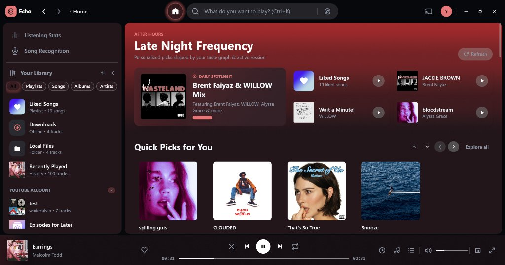
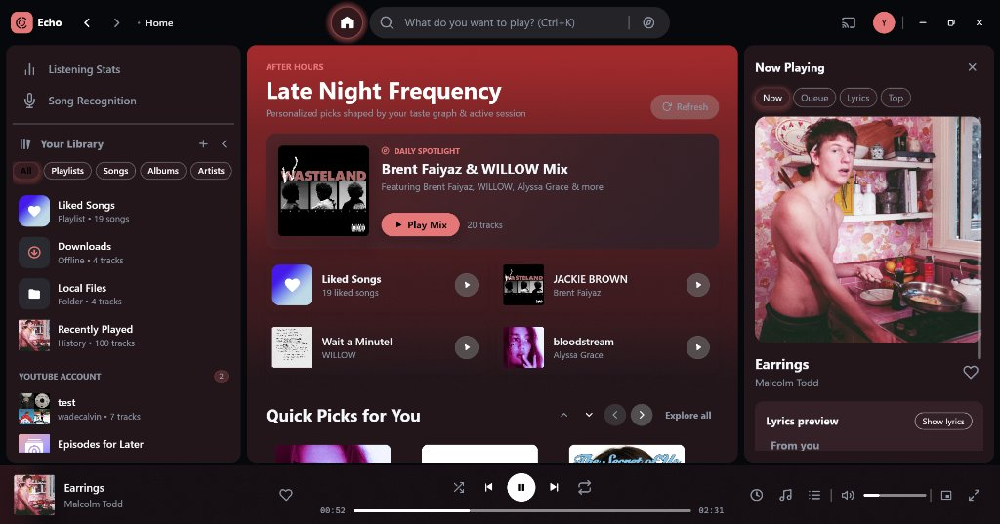
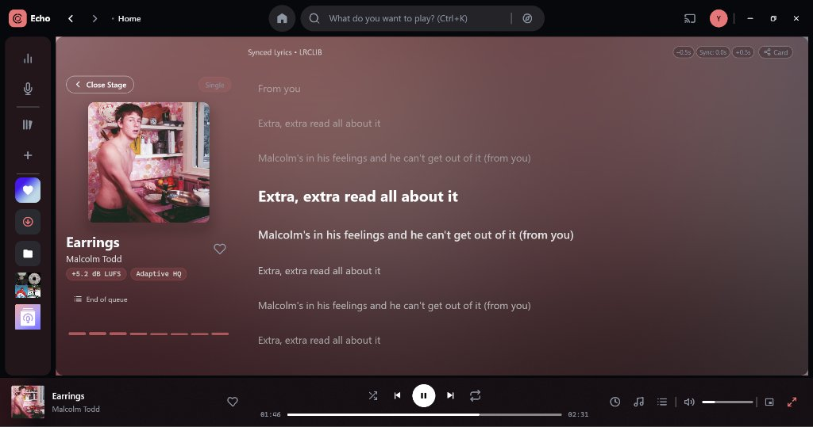
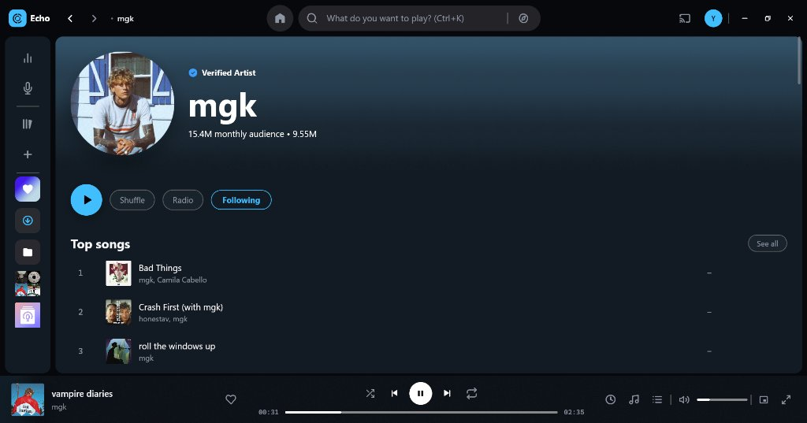
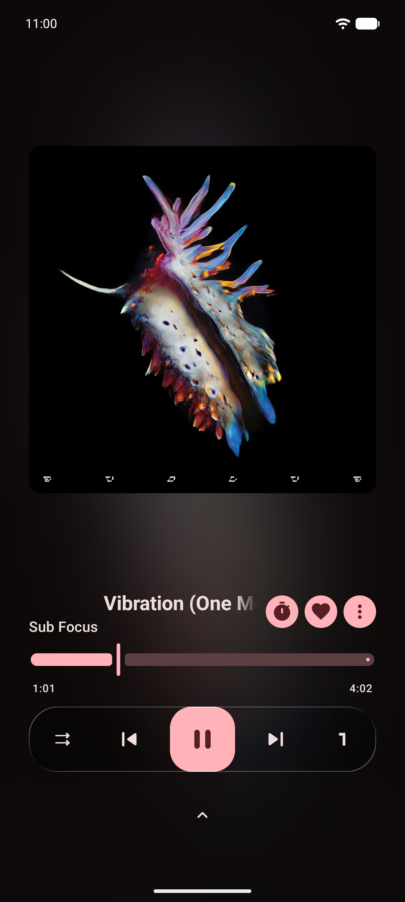
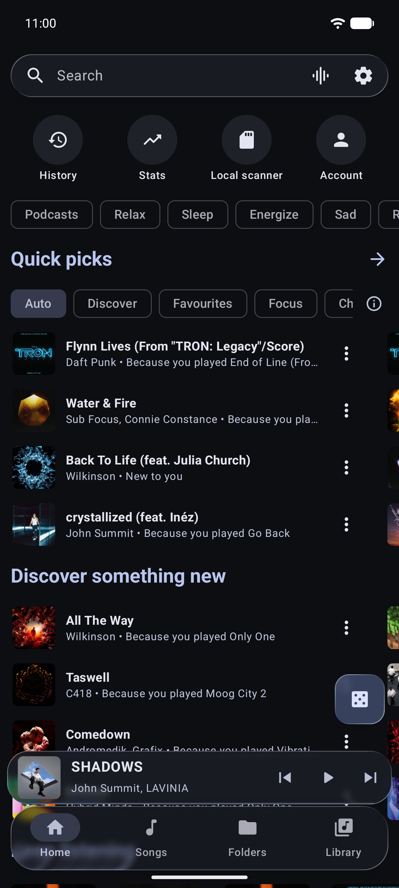
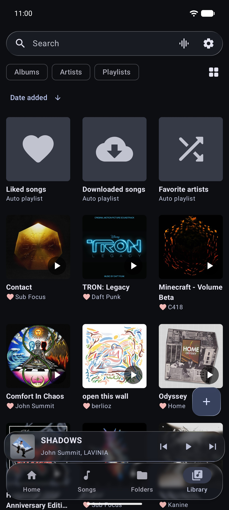
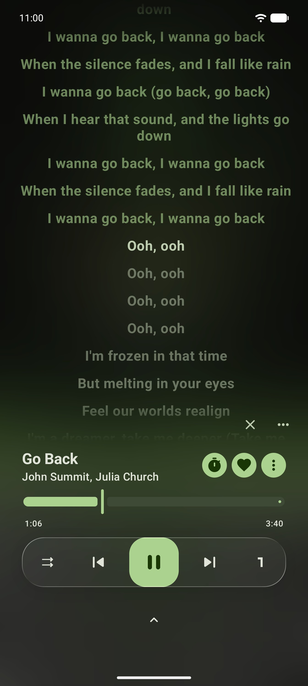

<div align="center">


# Echo Desktop

### Pure-Rust YouTube Music Streaming & Audiophile Desktop Music Player

[](https://github.com/wadecalvin9/echo-releases)
[-DEA584?style=for-the-badge&logo=rust&logoColor=white)](https://github.com/wadecalvin9/Echo-desktop)
[](https://www.gnu.org/licenses/gpl-3.0)
[](https://github.com/wadecalvin9)
[](https://github.com/wadecalvin9/echo-releases)

<p align="center">
  <a href="https://github.com/wadecalvin9/echo-releases/releases/download/v1.0.4/Echo-Setup-v1.0.4.exe"><b>[ Download Echo Desktop Installer (v1.0.4) ]</b></a> •
  <a href="https://github.com/wadecalvin9/echo-releases/releases/download/v1.0.4/Echo-Desktop-Windows-x64.zip">Portable Zip</a> •
  <a href="#screenshots">Screenshots</a> •
  <a href="#features">Features</a> •
  <a href="#keyboard-shortcuts">Shortcuts</a> •
  <a href="#echo-for-android">Echo for Android</a> •
  <a href="#building-from-source">Build from Source</a> •
  <a href="#about--creator">Creator</a>
</p>

</div>

---

## Overview

**Echo Desktop** is a lightning-fast, distraction-free desktop music player tailored for streaming YouTube Music and playing your personal offline music library. Built from the ground up in pure **Rust** with **Iced**, **Tokio**, **Symphonia**, and **CPAL**, Echo brings an audiophile-grade audio pipeline and a modern Spotify Desktop-inspired interface to Windows.

No telemetry. No advertisements. No mandatory account logins. Just instant, bit-perfect music playback.

---

## Screenshots

<div align="center">

### Home & Discover


<br/><br/>

### Now Playing & Lyrics Preview


<br/><br/>

### Expanded Synced Lyrics Stage


<br/><br/>

### Artist Detail & Verified Discography


</div>

---

## Features

- **Spotify Desktop-Style Top Navigation:**
  - Dedicated circular **Home** button adjacent to the search capsule.
  - Unified search pill with live autocomplete (`Ctrl+K`) and an embedded **Explore / Browse** button.
  - Draggable custom titlebar with seamless minimize/maximize/close controls and window state preservation.

- **Polished Responsive Shell:**
  - Modern collapsible left navigation rail with clean 44×44 squircle icons and zero visual scrollbar overlap.
  - Multi-pane layout: Left library rail, main content center, and right Now Playing / Queue panel.
  - Dynamic album-art responsive theming (`Dynamic`, `Dark`, `OLED True Black`).

- **YouTube Music Streaming & Account Sync:**
  - Personalized Home shelves, mood chips, quick picks, and daily spotlights.
  - Full catalog search with autocomplete suggestions, Artist, Album, and Playlist detail pages.
  - Optional isolated Google Sign-In helper (`echo-auth`) to sync your YouTube Music library, liked songs, and custom playlists.

- **Cinema-Style Expanded Lyrics Stage:**
  - Real-time synced lyrics from LRCLIB, KuGou, and Better Lyrics (TTML).
  - Click-to-seek line synchronization with smooth auto-scroll.
  - Romanization for CJK, Hangul, and Kana characters.
  - Interactive audio waveform bar and loudness LUFS display.

- **Song Recognition (Shazam / SongRec):**
  - 16 kHz mono audio fingerprinting with speed-retry fallback.
  - Identify songs playing anywhere on your PC via **WASAPI loopback** or microphone capture.
  - Recognition history saved to local database.

- **Audiophile DSP & Loudness Engine:**
  - Symphonia + CPAL playback pipeline with Echo loudness leveling (`-3 dB` reference).
  - Soft-clipped limiter boost up to `+12 dB`.
  - 10-band custom graphic equalizer + Harman AutoEQ headphone profiles.
  - Spatial audio widening, silence skipping, and smooth transition fades.
  - Configurable sleep timer and output device routing.

- **Storage, Cache & Local Library:**
  - LRU disk stream cache for instant offline replays.
  - Offline download manager and local folder indexing (`lofty` tag scanner + tree view).
  - SQLite persistence (`rusqlite`) for history, statistics, and playlists.
  - Full `.echobak` snapshot backup and restore.

- **Integrations:**
  - Last.fm Now Playing & scrobbling support.
  - Windows System Media Transport Controls (SMTC) and taskbar playback progress.
  - Google Cast / Chromecast, DLNA, and FCast device streaming.

---

## Echo for Android

Prefer listening on mobile? **Echo for Android** delivers the same lightweight, private music player experience with instant startup, swipe gestures, and true-black OLED mode:

<div align="center">
  
  &nbsp;
  
  &nbsp;
  
  &nbsp;
  
</div>

<p align="center">
  Download the latest Android APK from the <a href="https://github.com/wadecalvin9/echo-releases"><b>echo-releases repository</b></a>.
</p>

---

## Keyboard Shortcuts

| Shortcut | Action |
| :--- | :--- |
| `Ctrl+K` / `Ctrl+F` | Focus search bar |
| `Space` | Play / Pause |
| `Left` / `Right` | Seek `-5s` / `+5s` |
| `Shift + Left` / `Right` | Seek `-15s` / `+15s` |
| `Up` / `Down` | Volume `+5%` / `-5%` |
| `M` | Mute / Unmute |
| `L` | Like / Unlike current track |
| `Esc` | Close search dropdown, exit Expanded Lyrics Stage, or navigate back |
| `Media Keys` | Global Play/Pause, Next, Previous via Windows SMTC |

---

## Building from Source

### Prerequisites (Windows)
- [Rust toolchain](https://rustup.rs/) (stable channel)
- LLVM MinGW UCRT or MSVC toolchain

```powershell
# Clone the repository
git clone https://github.com/wadecalvin9/Echo-desktop.git
cd Echo-desktop

# Run unit and integration tests
cargo test --workspace

# Build optimized release binaries
cargo build --release -p echo-app -p echo-auth

# Run the app
./target/x86_64-pc-windows-gnullvm/release/echo-app.exe
```

---

## About & Creator

- **Lead Developer & Creator:** [wadecalvin9](https://github.com/wadecalvin9)
- **Source Repository:** [Echo-desktop](https://github.com/wadecalvin9/Echo-desktop)
- **Official Releases:** [echo-releases](https://github.com/wadecalvin9/echo-releases)
- **License:** GNU General Public License v3.0 (GPL-3.0-or-later)

---

<div align="center">
  <sub>Built with ❤️ in Rust for music lovers worldwide.</sub>
</div>
